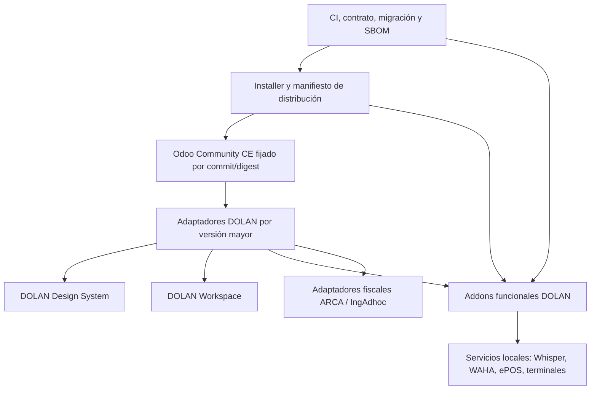

# Arquitectura objetivo — DOLAN Distribution

## Principios

1. Odoo Community es upstream, nunca un fork mantenido por DOLAN. Cada build fija una referencia inmutable de Odoo y cada base registra qué build la actualizó.
2. Los addons funcionales dependen de Odoo CE y de contratos DOLAN explícitos; no importan archivos de otro addon por rutas privadas.
3. Las referencias a APIs internas de Odoo se concentran en adaptadores por versión mayor y tienen pruebas de contrato.
4. La personalización de interfaz se mantiene en addons; se usan registries/extensiones públicas cuando existan, y las herencias OWL necesarias se documentan con plantilla fuente y fallback.
5. Las instalaciones y actualizaciones son artefactos declarativos: manifiesto de versiones, perfil/módulos, parámetros no secretos, imágenes y migraciones aplicadas. Secretos quedan fuera del manifiesto.
6. Cada actualización se prueba primero en una restauración de backup y sólo entonces puede promoverse.

## Capas

### A. Core upstream

- Fuente declarada en lock de distribución: repositorio, versión/serie, commit completo, digest de imagen y versión de Python/PostgreSQL.
- El Dockerfile de instalación y el de actualización se derivan de una sola receta versionada.
- Prohibido parchear el core durante build. Si una necesidad no puede resolverse con addon/adaptador, se registra excepción con archivo upstream, justificación, diff mínimo, test y fecha de retiro.

### B. Adaptadores por versión de Odoo

Un paquete `DOLAN_odoo20_adapter` concentra puentes dependientes de Odoo 20: registries OWL, plantillas, APIs POS, callbacks y capacidades del servidor. Los módulos funcionales llaman interfaces estables del adapter o servicios propios; no importan clases internas directamente.

El paquete expone capacidades nombradas (por ejemplo `pos.payment_terminal`, `web.app_drawer`, `account.invoice_list`) y reporta qué capacidades están disponibles. No se marca compatible con 21 hasta construir una variante/adaptador y pasar el mismo contrato contra Odoo 21 real.

### C. Design System y Workspace

- **DOLAN Design System:** tokens, temas claro/oscuro, iconografía Fluent/Tabler, componentes y helpers de accesibilidad.
- **DOLAN Workspace:** launcher, carpetas, orden, favoritos, preferencias por usuario y ayudas contextuales.
- La separación se hará en etapas: extraer contratos/servicios y tests primero; mover assets/datos sólo después. Mantener alias/dependencias de transición para no perder preferencias instaladas.

### D. Módulos funcionales

Dominios: base/configuración; contabilidad/fiscalidad; ventas/intercambio; POS/descuentos/pagos; inventario/balanza/impresión; IA/OCR/BI; WhatsApp; suscripciones/alquileres; fabricación/calidad. Cada addon declara dependencias mínimas, propietario, alcance, migración y suite de tests.

Las piezas físicamente distintas (terminales Clover/MP, impresoras, balanzas, WAHA, Whisper) implementan contratos de proveedor y no filtran protocolo a formularios contables/POS.

### E. Distribución y datos

El instalador mantiene un manifiesto con schema versionado, commit de Odoo, commit de cada upstream, hash de addon, catálogo de módulos, versión de imagen y migraciones. Nunca persiste contraseñas, llaves ARCA, claves de WhatsApp ni tokens.

El flujo de actualización: validar inventario → backup DB+filestore+config → construir imagen inmutable → restaurar en DB temporal → actualizar módulos seleccionados/migraciones → correr verificaciones → aprobar promoción → retener backup y plan de rollback. No ejecutar `-u all` como operación genérica de actualización.

## Compatibilidad

| Línea | Base | Garantía |
|---|---|---|
| Actual | Odoo CE 20.0 | Objetivo soportado; cada release debe pasar CI completa y upgrade de DB de prueba. |
| Próxima | Odoo CE 21 | No declarada. Se investiga cuando exista upstream verificable, se crea adapter independiente y se demuestra instalación, pruebas y migración. |

## Contratos de addon

- Dependencias Odoo declaradas, sin depender de orden casual de instalación.
- API pública propia documentada; no `env.registry`/internos de Odoo desde dominios que no son adaptador.
- Tests Python para permisos, compañía, montos y transiciones; tests JS para OWL/POS; tests de migración con DB desde release anterior.
- Fixtures sintéticos. Las pruebas que usan ARCA, OpenAI, bancos o terminales reales se separan como acceptance tests explícitos y nunca corren en CI pública.
