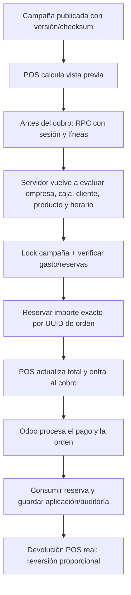

# Arquitectura de promociones y descuentos DOLAN

**Estado:** campañas, reservas antes del cobro, descuentos manuales supervisados, aplicaciones, devoluciones y beneficio de empleado identificado por DNI implementados en el addon local. El flujo DNI pasó pruebas automatizadas de backend; queda la prueba POS interactiva del usuario. Persisten brechas de aprobación del beneficio empleado, pagos promocionales, modo offline y validación integral.

## Fuente de verdad

Productos, variantes, categorías, unidad de medida, impuestos, listas de precio, POS, órdenes, pagos, devoluciones y diarios siguen siendo modelos nativos de Odoo. DOLAN publica reglas versionadas y guarda una aplicación de descuento por línea; no altera el precio maestro ni crea una segunda orden.

## Camino online

La reserva vence a las dos horas; se vuelve a validar al regresar a la pantalla de venta y entrar al cobro. Un presupuesto insuficiente produce un error antes del pago. El servidor no rebaja una promoción después de que una terminal pudo haber cobrado. Si el POS sincroniza una orden con una promoción sin reserva vigente, el servidor rechaza la orden en vez de ajustar el total.

Para beneficios de empleado el cajero ingresa el DNI en el botón dedicado. El servidor busca un beneficio vigente de la empresa, valida caja/productos/compra propia y topes, reserva el cupo diario y mensual con bloqueo de fila y entrega un token opaco de corta duración. El POS vuelve a validar el token y el importe al entrar al cobro. El DNI no se guarda en la orden ni en el recibo; el partner beneficiario y la configuración quedan restringidos al rol administrador.

## Reglas y snapshots

- Orden por prioridad y desempate estable por IDs. La primera regla gana; se acumula solo cuando la regla elegida y todas las previas declaran compatibilidad.
- Redondeo con la moneda de la compañía; descuento máximo nunca supera la base de línea.
- Calendario local IANA con inicio inclusivo, fin exclusivo, días y fechas excluidas.
- Filtro por producto, categoría, exclusiones, cliente y segmento.
- Las reglas por medio de pago no se publican: no existe aún una confirmación de adquirente persistida y verificable compartida por Clover/Mercado Pago con este motor.
- La publicación guarda snapshot y checksum. La edición requiere pausar y publicar una versión nueva.

## Descuento manual y devolución

Cada descuento manual requiere motivo y valida límite de POS. Si supera el límite, la orden no entra al pago hasta obtener aprobación de otro usuario. La aprobación se vincula a compañía, caja, UUID de orden/línea, producto e importe; expira y se consume una vez. El importe manual queda reportado junto a las aplicaciones de campaña.

Una devolución POS debe referenciar la línea original. El módulo crea una reversión inmutable, proporcional a la cantidad devuelta; el saldo del presupuesto promocional resta los importes revertidos.

## Seguridad

- ACL por función y reglas multiempresa; las reservas solo son visibles a la sesión propia.
- El cliente nunca define las reglas ni el importe autoritativo. Antes del cobro, un RPC ligado a sesión POS calcula y reserva.
- Las aplicaciones, versiones y reversiones no se editan ni eliminan desde formularios.
- Los errores de validación no persisten auditoría si la transacción entera revierte; para ello se usa el registro independiente de solicitudes de aprobación donde aplica.

## Brechas antes de release

1. Beneficios de empleados: DNI, elegibilidad, cupos con lock, consumo y reversión automática vía devolución POS implementados. Falta aprobación independiente y prueba funcional en una sesión POS interactiva.
2. Descuento por instrumento: requiere callback confiable del proveedor con importe/estado/ID idempotente y reglas de mix; Clover en navegador no ofrece ese dato al servidor y el adaptador MP actual aún no está enlazado a una confirmación POS firmada.
3. Offline: el POS quita campañas y descuentos manuales antes de cobrar si `navigator.onLine` es falso y mantiene la venta a precio normal; falta probar desconexiones que el navegador no detecta y sincronización diferida.
4. Alertas de anomalía y exportación XLSX propia: no están completas; pivot/lista usan capacidades nativas.
5. Verificación integral pendiente: instalación limpia, assets OWL en navegador, POS interactivo, impuestos, balanza, competencia real de presupuesto, aprobación, devolución, aislamiento multiempresa y rendimiento p95.

## Historial de QA

En `dolan_products_audit_20261105`, la suite de descuentos ejecutó 9 casos con 0 fallos/errores, y la suite DOLAN POS ejecutó 4 casos con 0 fallos/errores. El chequeo estático de JavaScript y la compilación de Python también pasaron. No se han hecho cobros reales ni cambios a producción en este trabajo.
